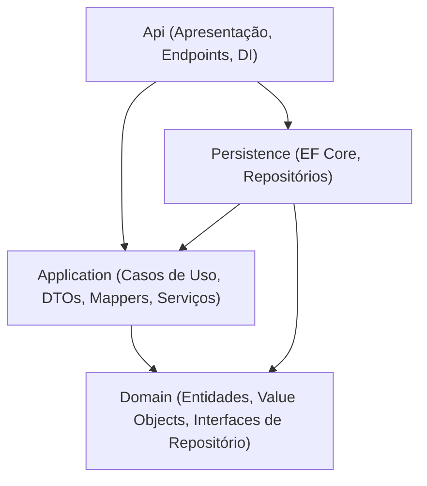

# 🏛️ Documento de Arquitetura - Taverna Web Backend

Este documento descreve a arquitetura de software, padrões táticos, fluxo de dependências e decisões de design adotadas no ecossistema backend do **Taverna Web**.

> 💡 **Guia Prático:** Para o tutorial passo a passo de como implementar uma nova feature do zero (código, migrations e testes), consulte o [Guia de Desenvolvimento (`Docs/Guia.md`)](Guia.md).

---

## 1. Visão Geral e Princípios Arquiteturais

O Taverna Web adota o padrão de **Monolito em Camadas** (*Layered Monolith*) combinado com os princípios da **Clean Architecture** (Arquitetura Limpa) e blocos táticos de **Domain-Driven Design (DDD)**.

### Objetivos do Design:
* **Independência de Frameworks:** As regras de negócio não dependem do banco de dados, da web ou de ferramentas externas.
* **Testabilidade:** Cada componente de negócio pode ser testado de forma isolada sem necessidade de mocks complexos de infraestrutura.
* **Baixo Acoplamento e Alta Coesão:** Cada camada possui responsabilidades bem delimitadas, separando claramente dados, orquestração e apresentação.
* **Não Exposição de Entidades:** Entidades de domínio e modelos do Entity Framework **nunca** são expostos diretamente nos endpoints da API. Toda entrada e saída passa obrigatoriamente por **DTOs**.
* **Preparado para Tempo Real:** Estruturado para conviver harmonicamente com APIs REST e canais bidirecionais de WebSockets/SignalR.

---

## 2. Diagrama de Dependências entre Camadas

O sistema segue estritamente a **Regra de Dependência**: as dependências de código-fonte sempre apontam para dentro (em direção ao `Domain`). Nenhuma camada interna pode conhecer ou importar classes de camadas superiores.

---

## 3. Detalhamento das Camadas

### 3.1. `Domain` (Núcleo Puro)
É o coração do sistema. Contém a lógica de negócio essencial e a representação conceitual do mundo do RPG de mesa.
* **Responsabilidades:**
  * **Model (`Model/`):** Entidades com identidade própria e validações de integridade (ex: `Usuario`).
  * **Value Objects (`ValueObject/`):** Objetos de valor imutáveis que se auto-validam (ex: `Email`).
  * **Interfaces de Repositório (`Interfaces/Repository/`):** Contratos abstratos de persistência (ex: `IUsuarioRepository`).
  * **Exceções de Domínio (`Exceptions/` e `Exceptions/Common/`):** Erros de negócio tipados (ex: `ConflictException`, `NotFoundException`, `UnauthorizedException`, `BadRequestException`).
* **Regra de Ouro:** **Zero dependências externas.** Não contém referências ao EF Core, ASP.NET Core, banco de dados ou bibliotecas de terceiros.

---

### 3.2. `Application` (Casos de Uso e Orquestração)
Orquestra o fluxo de dados entre a camada de apresentação e o domínio.
* **Responsabilidades:**
  * **Serviços de Aplicação (`Service/`):** Implementam os casos de uso (ex: `LoginService`, `CadastroService`).
  * **DTOs (`Dtos/`):** Objetos de transferência de dados divididos em `Request`, `Response` e `Command`.
  * **Mappers (`Mapper/`):** Conversores de dados dedicados (`LoginMapper`, `CadastroMapper`) para evitar repetição manual de código.
  * **Utilitários Transversais (`Utils/`):** Algoritmos utilitários puros como `Hash` (PBKDF2/SHA256) e `Token` (JWT).
  * **Abstrações de Contexto (`Interfaces/Common/`):** Contratos como `IAspNetUser`, permitindo que os serviços conheçam o usuário logado sem acoplar com o `HttpContext`.
* **Regra de Dependência:** Referencia exclusivamente o `Domain`.

---

### 3.3. `Persistence` (Infraestrutura de Dados)
Implementa o acesso e persistência física de dados utilizando o **Entity Framework Core**.
* **Responsabilidades:**
  * **DbContext (`Context/`):** `ApplicationDbContext` gerencia a sessão com o SQL Server.
  * **Mapeamentos Fluent API (`Configuration/`):** Classes que implementam `IEntityTypeConfiguration<T>` para configurar tabelas, índices e tipos de dados sem poluir as entidades de domínio com anotações de dados (*Data Annotations*).
  * **Migrations (`Migrations/`):** Histórico versionado de evolução do esquema do banco de dados.
  * **Repositórios (`Repository/`):** Implementações concretas das interfaces de repositório definidas no `Domain` (ex: `UsuarioRepository`).
* **Regra de Dependência:** Referencia `Application` e `Domain`.

---

### 3.4. `Api` (Apresentação e Infraestrutura Web)
Ponto de entrada de comunicação externa (HTTP REST e SignalR).
* **Responsabilidades:**
  * **Endpoints (`Endpoints/`):** Minimal APIs com rotas agrupadas sob o prefixo `/api` (ex: `MapLoginEndpoint`, `MapCadastroEndpoint`).
  * **Configurações e Injeção de Dependências (`Extensions/`):**
    * `InjecaoDependencias.cs`: Registro de serviços, repositórios e `IAspNetUser`.
    * `ConfiguracaoBanco.cs`: Configuração da Connection String e DbContext.
    * `AutenticacaoSeguranca.cs`: Configuração do Bearer JWT (Issuer, Audience, LifeTime, SecretKey).
    * `ConfiguracaoSwagger.cs`: Documentação OpenAPI com suporte ao botão *Authorize* para envio do token.
  * **Segurança (`Security/`):** Implementação concreta do `IAspNetUser` via `IHttpContextAccessor`.
  * **Middlewares:** Interceptação de autenticação, autorização e tratamento de exceções.
* **Regra de Dependência:** Referencia `Application` e `Persistence`.

---

### 3.5. `Test` (Garantia de Qualidade)
Projeto centralizado de testes automatizados com **xUnit**, organizado espelhando a arquitetura em camadas (`Test/Domain/`, `Test/Application/`).
* **Garantia de Regressão:** Todo novo método ou refatoração deve manter 100% dos testes aprovados (`dotnet test`).

---

## 4. Convenções de Nomenclatura (Padrão Obrigatório)

Regras rápidas de sufixo e prefixo para manter o código previsível e consistente:

* **Repositórios:** Métodos sempre terminam com **`RepositoryAsync`**  
  *Ex: `AdicionarUsuarioRepositoryAsync(...)`, `EmailJaCadastradoRepositoryAsync(...)`*
* **Serviços:** Interfaces `I{Nome}Service` e métodos com sufixo **`Async`**  
  *Ex: `CadastrarUsuarioAsync(...)`, `AutenticarAsync(...)`*
* **DTOs:** Sufixo obrigatório com seu propósito  
  *Ex: `LoginRequestDto`, `LoginResponseDto`, `LoginCommandDto`*
* **Mappers:** Classe estática `{Funcionalidade}Mapper`  
  *Ex: `LoginMapper.cs`, `CadastroMapper.cs`*
* **Endpoints:** Método de extensão `Map{Nome}Endpoint`  
  *Ex: `app.MapLoginEndpoint()`*

---

## 5. Padrões de Autenticação e Segurança

1. **Tokens JWT com Padrão RFC 7519 / HS256:**
   * Tokens assinados via HMAC-SHA256 utilizando chave simétrica (`JWT_SECRET_KEY`).
   * Validação estrita de **Emissor (`iss`)**, **Audiência (`aud`)** e **Tempo de Expiração (`exp`)**.
2. **Desacoplamento do Usuário Logado (`IAspNetUser`):**
   * Serviços de aplicação não acessam `HttpContext` diretamente.
   * A interface `IAspNetUser` lê as claims do token (`sub`, `email`) de forma transparente e desacoplada.
3. **Senhas Seguras com Salt Embutido:**
   * Criptografia de senhas usando algoritmo **PBKDF2 com Salt criptográfico** e 100.000 iterações em [`Hash.cs`](file:///home/brunin/Projetos/Taverna-Web/backend/taverna-web-backend/Application/Utils/Hash.cs).

---

## 6. Convenções de Código e Boas Práticas

* **Nomenclatura:** Pastas e arquivos em PascalCase.
* **Documentação de Endpoints:** Todos os endpoints devem explicitar metadados OpenAPI (`WithName`, `WithSummary`, `.Produces<T>`, `.ProducesProblem`).
* **Tratamento de Exceções:** Regras de negócio violadas lançam exceções de domínio correspondentes (`ConflictException`, `NotFoundException`, `UnauthorizedException`), que são capturadas para retorno de códigos HTTP padronizados sem poluir o código com blocos excessivos de `try/catch`.
* **Isolamento de Migrations:** Migrações pré-existentes nunca devem ser editadas; alterações no banco de dados devem sempre gerar uma nova migração incremental (`dotnet ef migrations add`).
